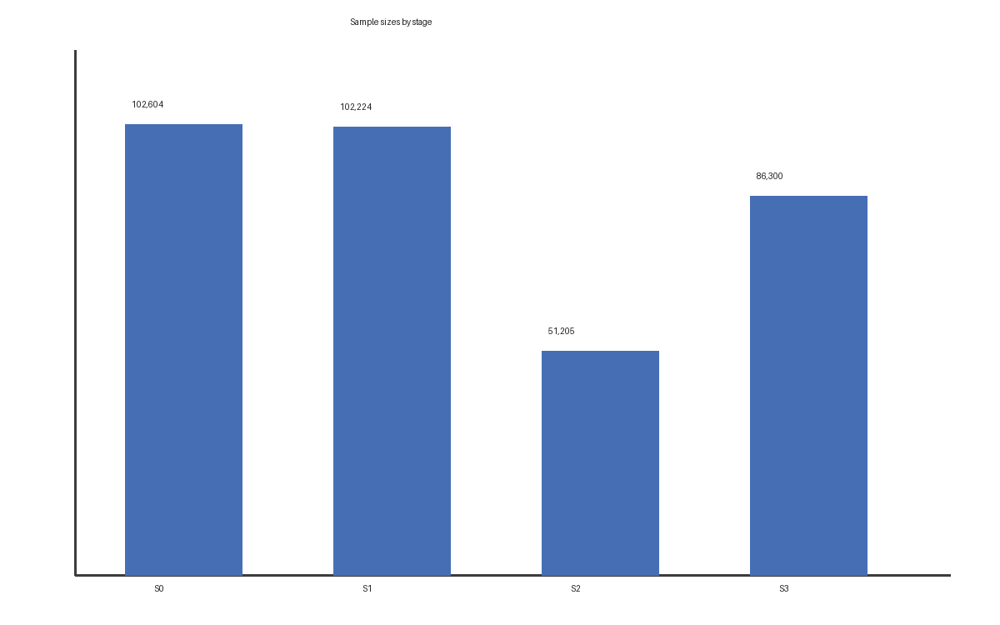

# 基于结构化数据的论文自动排版方法研究

> Markdown 初稿示例：`md2json` 与 `build` 都可直接读取本文件。

## 封面信息

| 项目 | 内容 |
| --- | --- |
| 论文题目 | 基于结构化数据的论文自动排版方法研究 |
| 课程名称 | R语言应用课程设计 |
| 学院／专业／班级 | 理学院／数据科学与大数据技术／2024级1班 |
| 学号／姓名 | 2024000001／张三 |
| 指导教师 | 李四 |
| 初稿日期 | 2026年10月 |

## 摘要

本文研究把结构化数据稳定转换为符合课程模板的论文文档的方法。程序以 JSON 为唯一输入，
依次生成封面、摘要、目录、正文、参考文献与附录，公式与图表交由文档格式本身表达。

**关键词**：论文排版；结构化数据；文档自动化；OOXML

## Abstract

This paper studies a deterministic pipeline that turns structured JSON into a thesis
document that follows the course template. Equations, captions and per-section page
numbering are expressed through the document format itself.

**Keywords**: document automation; structured data; OOXML; typesetting

## 目录

- 1.1 研究背景

# 第 1 章 绪论

## 1.1 研究背景

论文排版的质量取决于字体、字号、行距、编号与分节页码等确定性规则[1]。当这些规则由程序
表达时，同一份数据可以稳定地产生同一份文档，变量 $x_i$ 与公式都以标准公式对象插入。

# 第 2 章 方法与结果

## 2.1 模型与样本

设第 $i$ 个观测的解释变量为 $x_i$，响应为 $y_i$，线性模型写作：

$$
y_i = \beta_0 + \beta_1 x_i + \varepsilon_i,\qquad \varepsilon_i \sim \mathcal{N}(0,\sigma^2)
\tag{2-1}
$$

表 2-1 给出三个阶段的样本量。

表 2-1 各阶段样本量

| 阶段 | 说明 | 记录数 |
| --- | --- | ---: |
| S0 | 研究范围样本 | 102,604 |
| S1 | 核心变量完整 | 102,224 |
| S2 | 评价模型样本 | 51,205 |

注：各阶段按预定规则从上一阶段剔除，互斥计数不相加。



图 2-1 各阶段样本量对比

# 第 3 章 结论

## 3.1 主要结论

程序把版式规则固化为样式与分节属性，正文只描述结构，因此重复构建得到相同版式。

# 参考文献

[1] ISO/IEC 29500-1:2016. Office Open XML File Formats[S]. Geneva: ISO, 2016.

# 附录

## 附录 A 构建命令

```bash
python scripts/papermaker.py build references/example-paper.md -o out/example.docx
```
